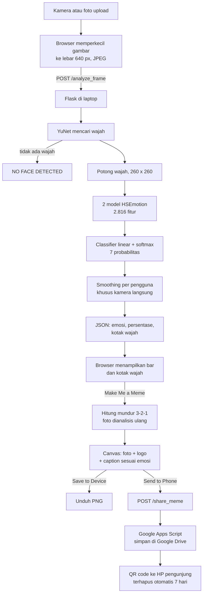

# MoodLens

**AI yang mengenali ekspresi wajah, lalu mengubahnya jadi meme.**

Riset oleh IRIS (Innovative Research on Intelligent System), Fakultas Teknologi Maju dan Multidisiplin, Universitas Airlangga.

---

## Penjelasan 30 detik untuk penjaga booth

> MoodLens adalah aplikasi AI yang menebak emosi dari ekspresi wajah. Kamera mengambil gambar wajahmu, lalu AI menilai seberapa besar kemungkinan kamu sedang senang, sedih, marah, takut, jijik, terkejut, atau netral. Setelah itu, wajahmu bisa langsung dijadikan meme dengan caption yang cocok dengan emosinya, dan bisa dibawa pulang lewat QR code. Semua proses AI berjalan di laptop ini, dan foto dari kamera tidak disimpan.

Kalau pengunjung ingin tahu lebih dalam, gunakan bagian [Cara kerja AI](#cara-kerja-ai) dan [Tanya jawab pengunjung](#tanya-jawab-pengunjung).

## Daftar isi

1. [Fitur](#fitur)
2. [Alur pengunjung di booth](#alur-pengunjung-di-booth)
3. [Cara kerja AI](#cara-kerja-ai)
4. [Dataset](#dataset)
5. [Akurasi dan keterbatasan](#akurasi-dan-keterbatasan)
6. [Alur teknis website](#alur-teknis-website)
7. [Stack teknologi](#stack-teknologi)
8. [Halaman website](#halaman-website)
9. [Privasi dan data](#privasi-dan-data)
10. [Tanya jawab pengunjung](#tanya-jawab-pengunjung)
11. [Menjalankan aplikasi](#menjalankan-aplikasi)
12. [Struktur folder](#struktur-folder)
13. [Kontak](#kontak)

---

## Fitur

| Fitur | Penjelasan |
|---|---|
| Deteksi emosi langsung | Kamera menganalisis wajah sekitar setiap 1,5 detik dan menampilkan persentase tujuh emosi. |
| Upload foto | Pengunjung bisa memakai foto dari perangkat sebagai ganti kamera. |
| Jadikan meme | Wajah diubah jadi meme dengan caption sesuai emosi yang terdeteksi. Logo UNAIR, FTMM, dan IRIS ikut tercetak di pojok gambar. |
| Hitung mundur 3-2-1 | Pengunjung punya waktu bergaya sebelum foto meme diambil. |
| Kirim ke HP | Meme diunggah ke Google Drive pameran, lalu muncul QR code untuk dibuka di HP. File terhapus otomatis setelah 7 hari. |
| Simpan ke perangkat | Meme bisa diunduh langsung sebagai file PNG. |
| Kenali emosimu | Halaman Emotions Spectrum menjelaskan arti tiap emosi dan alasan kita merasakannya. |
| Reset otomatis | Jika tidak ada wajah di depan kamera dan layar tidak disentuh selama 1 menit, halaman kembali ke tampilan awal untuk pengunjung berikutnya. |

## Alur pengunjung di booth

1. Buka halaman **Detect**, lalu tekan **Start Camera** atau **Upload Photo**.
2. Pengunjung menghadap kamera. Panel kanan menampilkan emosi dominan dan persentase ketujuh emosi.
3. Tekan **Make Me a Meme!**. Kamera menghitung mundur 3-2-1, lalu mengambil foto.
4. Meme muncul. Pilih **Save to Device**, **Send to Phone**, atau **Take Another** untuk mencoba lagi.
5. Untuk **Send to Phone**, pengunjung menyetujui penyimpanan 7 hari, lalu men-scan QR code dengan kamera HP.

Tips agar hasilnya bagus: satu orang saja di depan kamera, wajah terkena cahaya dan menghadap lurus, ekspresi dibuat jelas dan ditahan beberapa detik.

---

## Cara kerja AI

### Versi awam

Cara belajar AI ini mirip anak kecil. Setelah melihat ratusan ribu contoh foto wajah yang sudah diberi label (ini wajah senang, ini wajah sedih, dan seterusnya), AI mulai bisa menebak sendiri ekspresi wajah yang belum pernah ia lihat.

Setiap kali kamera mengambil gambar, ada empat langkah:

1. **Mencari wajah.** Komputer menemukan letak wajah di dalam gambar.
2. **Membaca ekspresi.** Wajah itu diamati oleh dua model AI yang masing-masing mengubahnya menjadi deretan angka yang mewakili ciri-ciri ekspresi.
3. **Memberi nilai.** Angka-angka itu diolah menjadi persentase untuk tujuh emosi. Emosi dengan nilai tertinggi menjadi hasilnya.
4. **Menghaluskan hasil.** Hasil dari beberapa gambar terakhir dirata-rata supaya tidak loncat-loncat.

Penting: AI ini **menebak ekspresi yang terlihat**, bukan membaca perasaan yang sebenarnya. Hasilnya untuk hiburan dan edukasi, bukan penilaian psikologis.

### Versi teknis

| Tahap | Detail |
|---|---|
| 1. Deteksi wajah | **YuNet** (`face_detection_yunet_2023mar.onnx`) lewat `cv2.FaceDetectorYN` di OpenCV. Ambang keyakinan 0,8. Jika ada beberapa wajah, yang dipakai wajah terbesar. |
| 2. Potong wajah | Kotak wajah diperlebar 10% di setiap sisi, lalu diubah ke RGB, diperkecil ke 260 × 260 piksel, dan dinormalisasi dengan rata-rata dan simpangan baku ImageNet. |
| 3. Ekstraksi fitur | Dua model **HSEmotion EfficientNet-B2** dalam format ONNX: `enet_b2_7_feat.onnx` (dilatih untuk 7 kelas) dan `enet_b2_8_feat.onnx` (8 kelas). Dari masing-masing model diambil vektor fitur sebelum lapisan klasifikasi, berukuran 1.408. Keduanya digabung menjadi 2.816 angka. |
| 4. Klasifikasi | Fitur distandarkan, lalu dimasukkan ke classifier linear baru (`emotion_head.npz`, bobot 7 × 2.816) yang dilatih ulang oleh tim dengan data RAF-DB dan AffectNet. Hasilnya diubah ke probabilitas dengan softmax. |
| 5. Smoothing | Untuk kamera langsung, probabilitas dirata-rata dari 6 hasil terakhir milik pengguna yang sama (sekitar 9 detik terakhir). Riwayat ini dipisah per sesi kamera dan direset saat wajah hilang. Foto meme dan foto upload tidak dihaluskan, supaya emosi di meme sesuai persis dengan fotonya. |

Model berjalan di CPU dengan **ONNX Runtime**, sekitar 0,1 detik per gambar di laptop pameran. Tidak perlu GPU maupun internet.

Tujuh emosi yang dikenali: senang (happy), sedih (sad), marah (angry), takut (fear), jijik (disgust), terkejut (surprise), dan netral (neutral).

## Dataset

| Dataset | Isi | Dipakai untuk |
|---|---|---|
| **AffectNet** | Kumpulan besar foto wajah dari internet dengan variasi usia, etnis, pencahayaan, dan sudut. Sekitar 450 ribu foto diberi label emosi secara manual. | Melatih dua model HSEmotion EfficientNet-B2 (pengekstrak fitur), serta melatih ulang classifier MoodLens. |
| **RAF-DB** (Real-world Affective Faces Database) | Sekitar 15 ribu foto wajah dunia nyata dengan label tujuh emosi dasar, masing-masing dinilai oleh banyak anotator. | Melatih ulang classifier MoodLens dan mengukur akurasinya. |

Model HSEmotion adalah model open-source dari proyek *High-Speed face Emotion recognition*. Tim MoodLens memakainya sebagai pengekstrak fitur, lalu melatih sendiri lapisan classifier di atasnya.

**Riwayat model:** versi awal MoodLens memakai model EfficientNet buatan sendiri yang dilatih dengan dataset **FER-2013** (`FacialExpressionModel.h5`, berbasis Keras/TensorFlow). Model itu sudah diganti, dan file-nya hanya disimpan sebagai arsip. Halaman About dan How It Works di website mungkin masih menyebut FER-2013.

## Akurasi dan keterbatasan

- **Akurasi:** 85,8% pada data uji RAF-DB, menurut pengujian tim. Di booth, hasilnya bisa berbeda karena pencahayaan, sudut wajah, dan ekspresi yang tidak tegas.
- **Persentase di layar** adalah probabilitas asli dari model, tanpa penyesuaian manual.
- **Ekspresi samar** sering tertukar, misalnya netral dengan sedih, atau senyum tipis dengan senang.
- **Satu wajah per gambar.** Jika ada beberapa orang, yang dianalisis hanya wajah terbesar.
- **Masker, kacamata hitam, atau wajah menyamping** menurunkan akurasi, atau membuat wajah tidak terdeteksi.
- **Hasil kamera agak tertunda** karena smoothing merata-rata hasil beberapa detik terakhir. Sarankan pengunjung menahan ekspresinya 3 sampai 5 detik.

---

## Alur teknis website



Catatan alur:

- Saat kamera menyala, browser mengirim satu gambar sekitar setiap 1,5 detik. Gambar berikutnya tidak dikirim sebelum hasil sebelumnya kembali.
- Meme dibuat sepenuhnya di browser memakai HTML Canvas. Caption dipilih acak dari **109 caption berbahasa Indonesia yang ditulis tim**, dikelompokkan per emosi. Caption tidak dibuat oleh AI.
- Foto kamera dicerminkan seperti selfie. Foto upload digambar apa adanya.

### Endpoint

| Method | Path | Fungsi |
|---|---|---|
| GET | `/` | Halaman depan |
| GET | `/detect` | Halaman deteksi, kamera, upload, dan meme |
| GET | `/how-it-works` | Panduan singkat pemakaian |
| GET | `/emotions` | Emotions Spectrum (carousel tujuh emosi) |
| GET | `/emotion/<nama>` | Penjelasan satu emosi |
| GET | `/about` | Tentang project |
| POST | `/analyze_frame` | Menerima gambar (base64) dan `client_id` opsional, mengembalikan emosi, persentase, dan kotak wajah |
| POST | `/share_meme` | Menerima meme JPEG, mengunggahnya lewat Apps Script, mengembalikan URL dan gambar QR |

## Stack teknologi

| Bagian | Teknologi |
|---|---|
| Bahasa | Python 3.11 |
| Web server | Flask 3.0 dengan template Jinja; Gunicorn untuk deploy |
| Deteksi wajah | OpenCV 4.14 (YuNet) |
| Model emosi | ONNX Runtime 1.31, NumPy |
| Frontend | HTML, CSS, dan JavaScript tanpa framework; `getUserMedia` untuk kamera; HTML Canvas untuk meme |
| Font | Plus Jakarta Sans, disimpan lokal agar bisa berjalan tanpa internet |
| Kirim ke HP | Google Apps Script dan Google Drive; library `qrcode` untuk gambar QR; `python-dotenv` untuk membaca `.env` |
| Deploy | Docker (Python 3.11-slim), siap untuk Hugging Face Spaces |
| File besar | Git LFS untuk model dan gambar |

## Halaman website

| Halaman | Isi |
|---|---|
| Home | Pengenalan singkat dan tombol mulai deteksi |
| Detect | Kamera dan hasil emosi berdampingan, upload foto, hitung mundur, hasil meme, Send to Phone |
| How It Works | Langkah pemakaian untuk pengunjung |
| Emotions Spectrum | Carousel tujuh emosi; setiap kartu membuka halaman penjelasan emosi |
| About | Latar belakang project dan teknologi |

Semua halaman memakai navbar dan footer yang sama (`templates/base.html`). Footer berisi logo IRIS, FTMM, dan UNAIR. Tampilan responsif untuk layar laptop maupun HP.

## Privasi dan data

- Gambar dari kamera dan foto upload **hanya dianalisis di laptop booth**, diproses di memori, dan **tidak disimpan** ke disk.
- Meme **hanya disimpan jika pengunjung memilih Send to Phone** dan menyetujuinya. File-nya disimpan di Google Drive akun pameran, bisa dibuka oleh siapa pun yang memegang link-nya, dan **dihapus permanen otomatis setelah 7 hari**. Pengelola akun pameran juga bisa melihat isi folder tersebut.
- Server hanya mengingat riwayat probabilitas sementara untuk smoothing (paling banyak 200 sesi), bukan gambar.

## Tanya jawab pengunjung

**Apakah fotoku disimpan?**
Tidak. Gambar dari kamera hanya dianalisis lalu dibuang. Meme baru tersimpan kalau kamu memilih Send to Phone, dan itu pun terhapus otomatis setelah 7 hari.

**Seberapa akurat AI-nya?**
Pada data uji RAF-DB akurasinya 85,8%. Di dunia nyata hasilnya dipengaruhi cahaya, sudut wajah, dan seberapa jelas ekspresinya.

**Kenapa hasilnya beda dengan perasaanku?**
AI hanya membaca ekspresi yang terlihat di wajah, bukan isi hati. Senyum sopan bisa terbaca senang walaupun sebenarnya biasa saja.

**Kenapa hasilnya lambat berubah?**
Hasil kamera dirata-rata dari beberapa detik terakhir supaya stabil. Tahan ekspresimu 3 sampai 5 detik.

**AI-nya belajar dari mana?**
Dari ratusan ribu foto wajah berlabel emosi di dataset AffectNet dan RAF-DB.

**AI-nya jalan di internet?**
Tidak. Semua perhitungan AI berjalan di laptop ini. Internet hanya dipakai untuk fitur Send to Phone.

**Kalau berdua di depan kamera?**
Yang dianalisis hanya wajah terbesar, biasanya yang paling dekat ke kamera.

**Caption meme-nya dibuat AI?**
Bukan. Ada 109 caption yang ditulis tim, dan aplikasi memilih satu secara acak sesuai emosimu.

**Bisa dicoba di rumah?**
Untuk saat ini MoodLens hanya bisa dicoba di booth. Ikuti Instagram @irisearch untuk kabar selanjutnya.

---

## Menjalankan aplikasi

### Kebutuhan

- Python 3.11
- Git dan [Git LFS](https://git-lfs.com) (file model disimpan lewat LFS)
- Webcam dan browser modern (Chrome atau Edge)

### Di komputer lokal

```bash
git lfs install
git clone https://github.com/nOtZyll/moodlens-app.git
cd moodlens-app
py -3.11 -m venv .venv
.venv\Scripts\python -m pip install -r requirements.txt
.venv\Scripts\python app.py
```

Lalu buka http://localhost:5000. Pastikan folder `models/` berisi file ONNX berukuran sekitar 30 MB. Jika ukurannya hanya beberapa ratus byte, jalankan `git lfs pull`.

### Mode pameran (kiosk)

1. Siapkan virtual environment seperti di atas (cukup sekali).
2. Klik dua kali `start-exhibition.bat`. Script ini menyalakan server, menunggu model selesai dimuat, lalu membuka halaman Detect layar penuh di Microsoft Edge.
3. Klik **Allow** saat browser meminta izin kamera.
4. Untuk keluar dari layar penuh, tekan Alt+F4, lalu tutup jendela "MoodLens server".

Aplikasi bisa berjalan tanpa internet, kecuali fitur Send to Phone.

### Kirim ke HP lewat QR (Google Drive)

Tanpa pengaturan ini, tombol Send to Phone tidak muncul dan fitur lain tetap berjalan.

1. Buat akun Gmail khusus pameran (jangan akun pribadi atau akun @unair.ac.id, karena akun kampus sering melarang berbagi link publik), lalu login di browser.
2. Buka https://script.google.com, klik **New project**, lalu ganti nama project menjadi "MoodLens Share".
3. Hapus isi `Code.gs` di editor, salin seluruh isi `apps-script/Code.gs` dari repo ini, lalu klik **Save**.
4. Pilih fungsi `setup` di dropdown sebelah tombol Run, lalu klik **Run**. Saat diminta izin: Review permissions, pilih akun pameran, Advanced, Go to MoodLens Share (unsafe), lalu Allow. Peringatan "Google hasn't verified this app" muncul karena script ini buatan sendiri.
5. Di Execution log akan muncul baris `DRIVE_UPLOAD_TOKEN=...`. Salin nilainya. Fungsi `setup` juga membuat folder "MoodLens Memes" dan jadwal penghapusan otomatis setiap jam.
6. Klik **Deploy**, **New deployment**, ikon roda gigi, lalu **Web app**. Atur *Execute as: Me* dan *Who has access: Anyone*. Klik Deploy, lalu salin Web app URL yang berakhiran `/exec`. Untuk mengecek, buka URL itu di browser; jika muncul `{"ok":true,...}` berarti sudah benar.
7. Salin `.env.example` menjadi `.env`, lalu isi `DRIVE_UPLOAD_URL` dan `DRIVE_UPLOAD_TOKEN`. Jangan bagikan file `.env`; file ini tidak ikut ke git.
8. Restart server.

Jika `Code.gs` diubah, deploy ulang lewat **Manage deployments**, ikon pensil, **Version: New version**, lalu Deploy. URL-nya tetap sama.

### Deploy dengan Docker atau Hugging Face Spaces

```bash
docker build -t moodlens .
docker run -p 7860:7860 moodlens
```

Aplikasi berjalan di port 7860 dengan Gunicorn. File `.env` sengaja tidak ikut ke image (lihat `.dockerignore`). Untuk Send to Phone di Hugging Face Spaces, isi `DRIVE_UPLOAD_URL` dan `DRIVE_UPLOAD_TOKEN` di **Settings, Variables and secrets**. Kamera di browser hanya bisa dipakai lewat HTTPS atau localhost.

## Struktur folder

```
moodlens-app/
├── app.py                  Server Flask: halaman, deteksi wajah, model emosi, Send to Phone
├── models/                 Model ONNX (Git LFS)
│   ├── face_detection_yunet_2023mar.onnx   Deteksi wajah YuNet
│   ├── enet_b2_7_feat.onnx                 HSEmotion EfficientNet-B2, 7 kelas
│   ├── enet_b2_8_feat.onnx                 HSEmotion EfficientNet-B2, 8 kelas
│   └── emotion_head.npz                    Classifier linear 7 emosi buatan tim
├── templates/              Halaman HTML (Jinja), base.html berisi navbar dan footer
├── static/
│   ├── css/style.css       Gaya seluruh website
│   ├── js/webcam.js        Kamera, upload, hitung mundur, meme, caption, Send to Phone
│   ├── fonts/              Plus Jakarta Sans (lokal)
│   └── images/             Logo, ilustrasi emosi, foto halaman depan
├── apps-script/Code.gs     Script Google Drive untuk Send to Phone
├── start-exhibition.bat    Menyalakan server dan membuka mode kiosk
├── Dockerfile              Deploy ke Docker atau Hugging Face Spaces
├── requirements.txt        Library Python
├── .env.example            Contoh pengaturan Send to Phone
├── FacialExpressionModel.h5, LabelEncoder.pck, cek_label.py
│                           Arsip model versi awal (FER-2013), tidak dipakai lagi
└── README.md
```

## Kontak

IRIS (Innovative Research on Intelligent System), FTMM Universitas Airlangga

- Email: irisearch.ftmm@mail.unair.ac.id
- Instagram: [@irisearch](https://instagram.com/irisearch)
- LinkedIn: [linkedin.com/company/iris-ftmm](https://linkedin.com/company/iris-ftmm)
